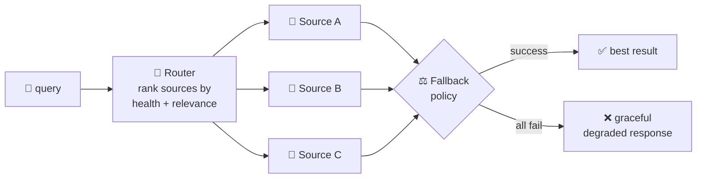

# universal-search-fuzzer

> **One query in, best answer out — across every search source you've got.** A multi-source search router with smart fallback: when a provider flakes, rate-limits, or returns junk, the router fails over instead of failing you.

## Why you should care

Every search API has a bad day — rate limits, outages, degraded relevance. If your app depends on a single provider, its bad day is your outage. **universal-search-fuzzer** is built on one idea: *route each query across multiple sources and fall back smartly*, so a dead provider degrades your results instead of killing them.

## Status

🚧 **Pre-implementation.** This repository currently contains only this README. The router implementation — source adapters, routing policy, and fallback logic — is pending. What follows is the intended design, not shipped code.

## Intended design

- **Multi-source** — query several search backends per request; don't bet on one.
- **Smart fallback** — health-aware routing: skip sources that are down or rate-limited, retry with backoff, and merge/dedupe what comes back.
- **Graceful degradation** — partial results beat no results; a total outage returns a structured degraded response, not an exception.

## Roadmap

- [ ] Core router: per-query source selection by health + relevance
- [ ] Source adapters (plug-in interface for new backends)
- [ ] Fallback policy: retries, backoff, circuit-breaking
- [ ] Result merging + deduping
- [ ] Tests: simulated provider outages, latency budgets

## Contributing

Open an issue or PR against this repo. Until the first implementation lands, design discussion in issues is the most useful contribution.

## License & security

No license file has been declared yet — all rights reserved by default until one is added. When source adapters arrive, note that each search backend has its own API keys and rate limits; keys stay in your environment, never in the repo.
